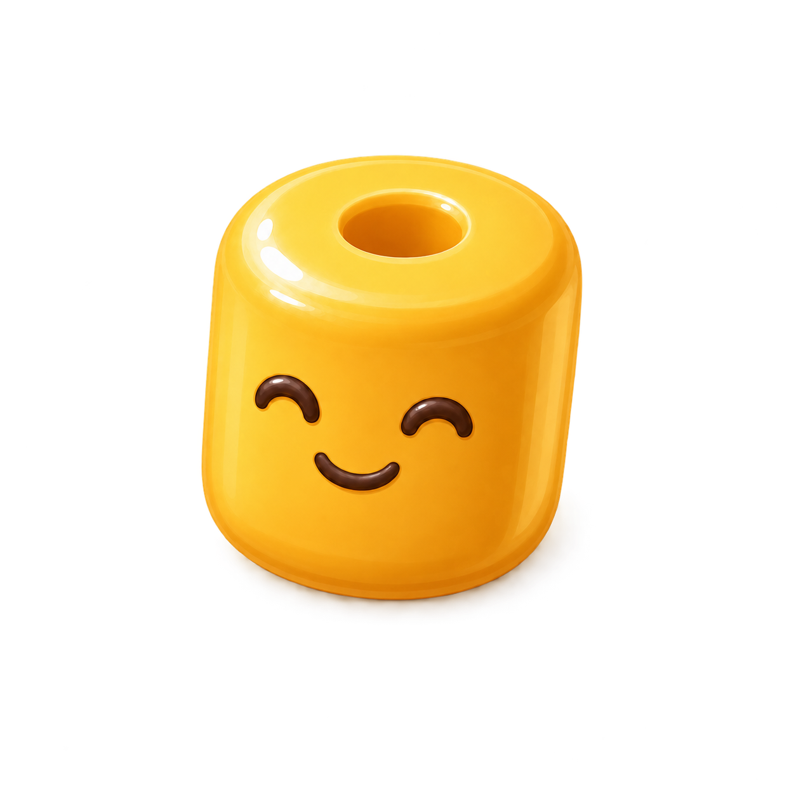
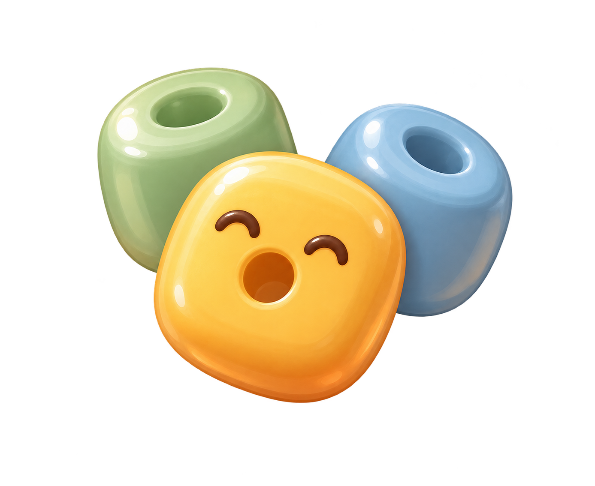

# 心情豆视觉与局内表现规范 v1

> 状态：阶段 A 正式视觉基线（2026-08-20）  
> 适用项目：《烦恼排排消》Cocos Creator 2.4.13 微信小游戏  
> 目标读者：负责实现局内收集动画、HUD 与结算界面的模型，以及后续验收模型  
> 本文只定义“心情豆”的概念、造型和使用方式，不代表已经产出十套正式运行素材。

---

## 1. 一句话定义

**心情豆是带心情符号的色块被消除后，直接显现并被玩家收集的一颗拼豆。**

它不是表情换算出的货币，也不是瓶子、金币或经验值。玩家能观察到的固定因果关系是：

```text
1 个带心情符号的色块被消除
→ 该色块的心情符号变成 1 颗同色、同表情的心情豆
→ 心情豆飞入局内收集位
→ 本局心情豆数量 +1
```

广告加成只能在结算中作为额外奖励单独展示，不得把局内的单颗收集表现改成 `+10`、`+50` 等换算关系。

---

## 2. 正式母版

### 2.1 单颗心情豆母版：正式参考



文件：[`docs/art-sources/formal/mood_bean_single_reference_v2.png`](art-sources/formal/mood_bean_single_reference_v2.png)

- 原图为 1254×1254 RGBA 透明 PNG；
- 只作为造型、材质、光影和构图参考，不建议把该高分辨率原图直接打进微信运行包；
- 顶部小孔用于明确“拼豆/手工豆”身份；
- 表情完整绘制在正面侧壁，孔与嘴严格分离；
- 十种心情共用这套豆体结构，只替换主体色和现有表情线稿。

### 2.2 心情豆余额簇：构图参考



文件：[`docs/art-sources/formal/mood_bean_cluster_reference_v1.png`](art-sources/formal/mood_bean_cluster_reference_v1.png)

这张图只参考“三颗不同颜色豆子组成通用资产图标”的构图。正式实现时，簇内每颗豆的造型仍应采用上方 v2 母版，不能把中央孔当成嘴。

旧版“正面圆孔同时充当嘴”的方案已移入 `docs/art-sources/formal/rejected/`，不得用于正式实现，因为它无法承载十种不同嘴型。

---

## 3. 为什么采用这个造型

### 3.1 必须一眼看出是“豆”，而不是货币

主体使用短圆柱拼豆结构，而不是圆币、宝石或玻璃球。顶部小孔提供品类识别，轻微厚度和左上高光与项目现有半立体心情块一致。

### 3.2 必须继承来源心情

玩家收集的不是无差别货币，而是刚刚从心情块中释放出来的“小心情”。所以单颗飞行豆必须继承来源色块的：

- `moodIndex`；
- 主体颜色；
- 眼睛和嘴型；
- 积极或轻度消极的情绪语气。

### 3.3 必须兼容后续拼画

局内豆子是有体积、有表情的收藏物；秘境棋盘中的豆位是远景像素化表达。两者不要求逐像素同形，但都通过“圆角彩豆 + 拼豆孔/格阵语义”建立同一世界观。

---

## 4. 十种颜色与表情继承

颜色必须直接复用 `assets/script/zyxGame/MoodArt.ts` 中的 `MOOD_VISUALS`，不要另建一套近似色。

| moodIndex | 心情 | 主体色 | 性质 |
|---:|---|---|---|
| 1 | 欢喜 | `#F1C255` | 积极 |
| 2 | 安心 | `#7EBE9D` | 积极 |
| 3 | 期待 | `#EF9769` | 积极 |
| 4 | 温柔 | `#E49A97` | 积极 |
| 5 | 得意 | `#AEC75B` | 积极 |
| 6 | 放松 | `#6FABC4` | 积极 |
| 7 | 犹疑 | `#E2A356` | 轻度消极 |
| 8 | 烦躁 | `#CD6560` | 轻度消极 |
| 9 | 委屈 | `#8997BF` | 轻度消极 |
| 10 | 郁闷 | `#977C84` | 轻度消极 |

共用辅助色：

- 表情线稿：可可棕 `#583D37`；
- 暖色反光：奶油白 `#FFF6E0`，低透明度；
- 阴影：主体色向可可棕压暗，不使用纯黑；
- 光源：固定来自左上方，与现有心情块保持一致。

表情必须复用现有 `drawMoodFace` 的十种眼睛和嘴型。不得只给十种豆子换色、却全部使用同一张笑脸。

---

## 5. 几何与小尺寸标准

以图标安全区宽度 `S` 为基准：

| 部位 | 建议比例 |
|---|---:|
| 豆体总宽 | `0.68S～0.74S` |
| 豆体总高 | `0.58S～0.66S` |
| 顶部孔直径 | 豆体宽的 `10%～14%` |
| 正面表情宽 | 豆体宽的 `44%～52%` |
| 四周透明留白 | 每侧至少 `12%S` |

使用尺寸：

| 场景 | 建议显示尺寸 | 要求 |
|---|---:|---|
| 心情块释放/飞行 | 38～42 设计像素 | 孔、双眼和嘴型都能辨认 |
| 局内 HUD 通用图标 | 44～52 设计像素 | 使用三豆簇或重绘后的简化豆簇 |
| 结算单项图标 | 64～72 设计像素 | 可展示完整半立体光影 |
| 教程或说明弹窗 | 96～128 设计像素 | 可以使用正式母版大图 |

小尺寸验收必须在真实游戏缩放链路中完成，不能只看 1254px 原图。38px 下优先保住轮廓、孔和表情，允许减少高光层级。

---

## 6. 局内动画规范

### 6.1 单颗收集

1. 带心情符号的色块进入消除状态；
2. 色块上的表情线稿在 `0.10～0.16s` 内轻微收拢，同时豆体显现；
3. 生成与来源 `moodIndex` 一致的单颗心情豆；
4. 心情豆沿现有贝塞尔飞行路径飞向顶部心情豆 HUD，建议 `0.45～0.65s`；
5. 到达时 HUD 图标轻弹一次，数量严格 `+1`；
6. 经验在结算时独立处理，不与心情豆共用飞行目标或数字。

### 6.2 同时收集多颗

- 每个带心情符号的色块对应一颗可见心情豆；
- 同一行内依次错开 `0.03～0.06s` 起飞，避免完全重叠；
- HUD 数字按到达顺序逐颗增加，最终值必须与实际收集数一致；
- 不显示“一个表情飞行后突然 +50”的换算表现。

### 6.3 结算与首页

- 局内 HUD 只显示本局收集数；
- 结算面板显示“本局收集 心情豆 ×N”；
- 首页资产卡显示长期总余额；
- 通用余额图标可使用三色豆簇，但任何单颗飞行动画都必须显示来源心情。

---

## 7. 实施边界

阶段 A 推荐在 `MoodArt.ts` 中用程序绘制方式建立统一的 `createMoodBean` 能力，并复用现有 `getMoodColor` 与 `drawMoodFace`：

- 豆体由侧壁、顶部椭圆、顶部孔、左上高光和右下柔影组成；
- 同一几何结构根据 `moodIndex` 换色和换表情；
- 原有圆形 `createMoodToken` 不再作为正式心情豆使用；
- 高分辨率参考图保留在 `docs/`，不直接进入运行 Bundle；
- 如果最终改用位图，应输出经过压缩的小尺寸图集并检查微信包体，而不是复制十份 1254px PNG。

当前任务只交付视觉规范和参考资产，不代表授权 Codex 修改运行代码。

---

## 8. 禁止项

- 不做金币外圈、币值刻痕或货币符号；
- 不做宝石切面、玻璃材质或强烈发光；
- 不做糖果包装、糖霜或可食用质感；
- 不做瓶子、瓶盖或装瓶过程；
- 不把顶部孔当成嘴；
- 不让顶部孔大到使整体变成甜甜圈；
- 不使用纯黑描边、冷灰金属阴影或写实塑料反射；
- 不让所有颜色共用同一表情；
- 不在单颗飞行动画上显示大于 1 的资源换算值。

---

## 9. 阶段 A 验收清单

- [ ] 一个带心情符号的色块只产生一颗心情豆，数量只增加 1；
- [ ] 飞出的豆与来源色块颜色、表情一致；
- [ ] 顶部孔与正面嘴型互不占用；
- [ ] 十种心情均能独立辨认，不是只换颜色；
- [ ] 38px 下仍能辨认豆形、孔和主要表情；
- [ ] HUD 通用图标与单颗豆体属于同一造型体系；
- [ ] 玩家不会把它误认为金币、糖果、宝石或瓶盖；
- [ ] 参考大图未被无压缩地打入微信运行包；
- [ ] 经验、心情豆和广告加成三套数字语义没有混用。

---

## 10. 本次图像生成记录

生成工具：Codex 内置 `imagegen`。

正式母版设计提示词：

```text
Use case: stylized-concept. Create one transparent-background game UI collectible icon and shape master for ten mood variants. Exactly one short upright cylindrical craft/perler bead in a clear 3/4 top-front view. The TOP shows a small circular hole; the FRONT SIDE WALL separately contains a complete cute facial expression, so the hole and mouth remain separate for ten different expressions. Use a honey-yellow body, height about 70% of width, a very slight friendly tilt, cocoa-brown curved eyes and smile, warm cream top-left highlight, soft darker lower-right thickness and a subtle translucent contact shadow. Match a warm Japanese mobile-game UI with soft rounded semi-3D material and all-age emotional comfort. The face must remain readable at 38 px. Genuine transparent RGBA background. Exactly one bead, centered, no text and no other objects. Avoid donut/torus, face arranged around the hole, coin, candy, gem, bottle, currency styling, oversized hole, photorealistic plastic, hard black outline and cold metallic shadow.
```

透明背景修正提示词：

```text
Precise background extraction edit. Keep the single honey-yellow upright short cylindrical craft/perler mood bead exactly unchanged: same silhouette, proportions, 3/4 top-front angle, small top hole, cocoa curved eyes and separate smiling mouth, warm cream highlight, soft polished mobile-game UI rendering. Remove the entire gray-and-white checkerboard background and all background pixels. Output genuine alpha transparency (RGBA) around the bead, with clean antialiased edges and the existing subtle contact shadow retained only as translucent pixels. Exactly one bead, centered, no text, no extra objects, no border, no checkerboard, no white background. This is a transparent PNG game UI icon reference.
```
